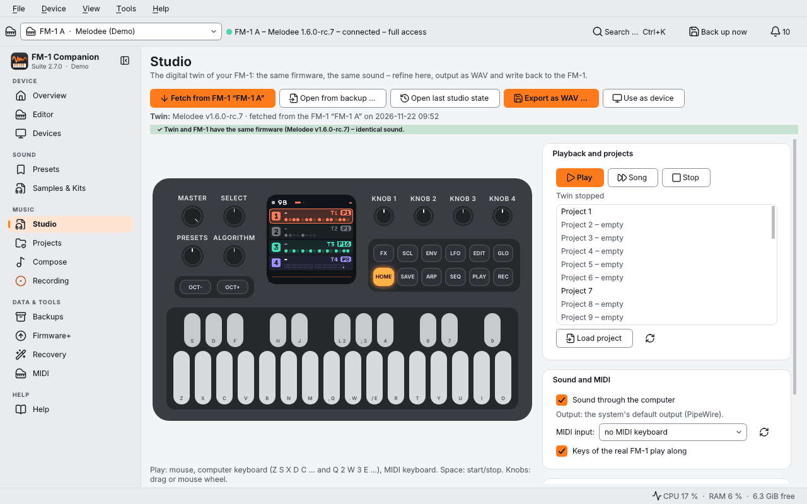
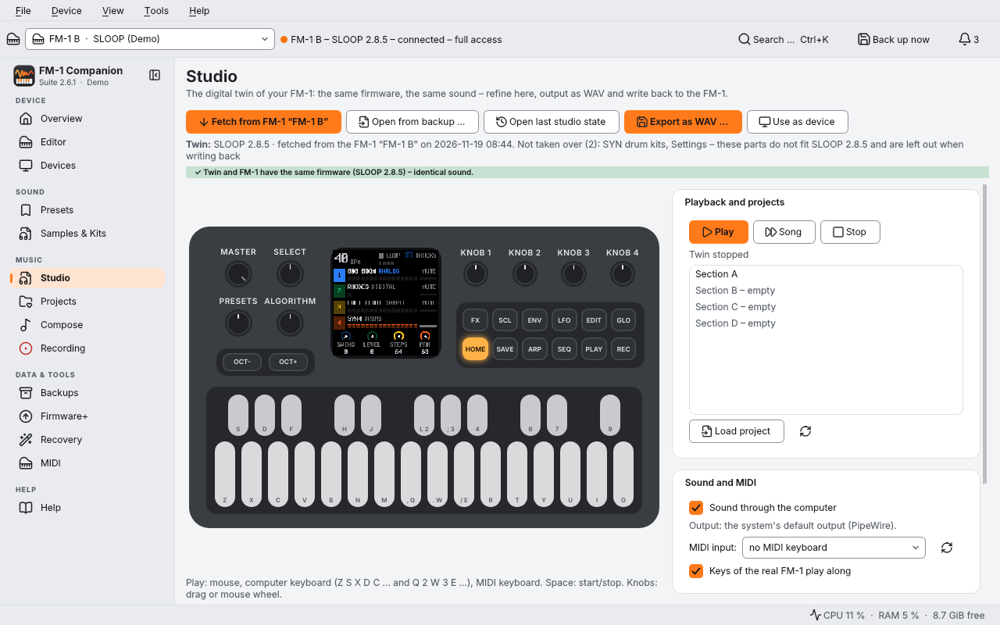
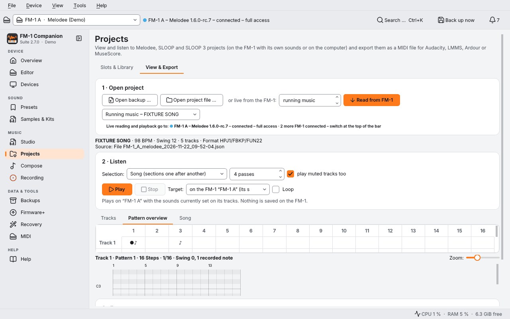
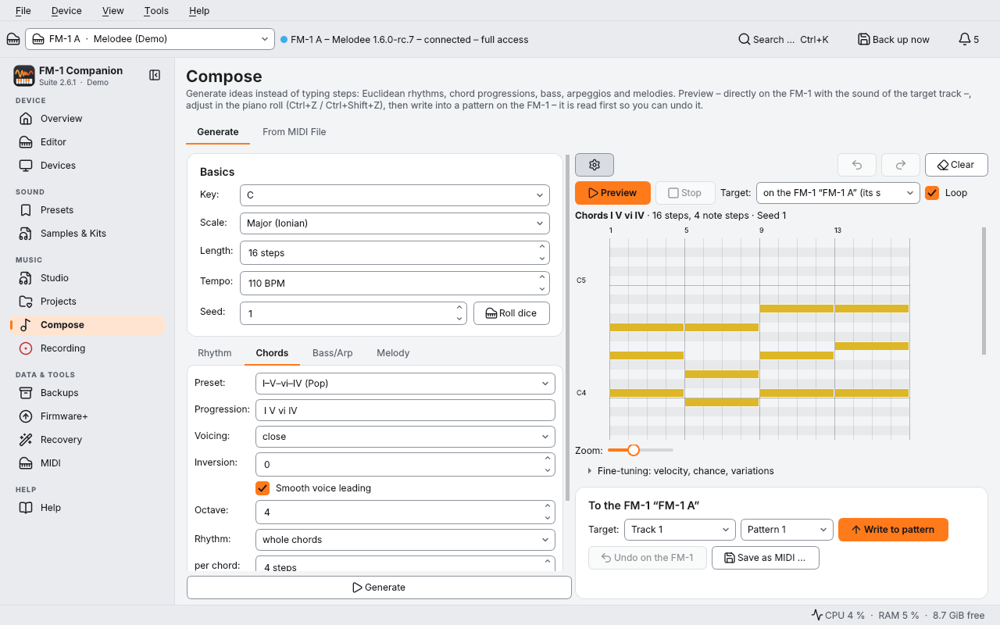
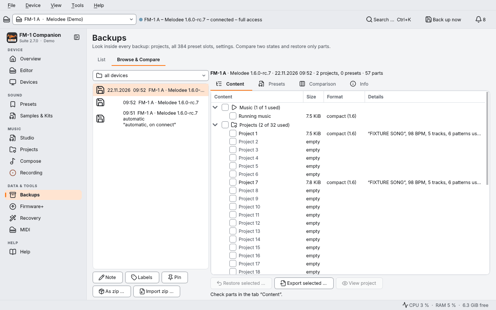
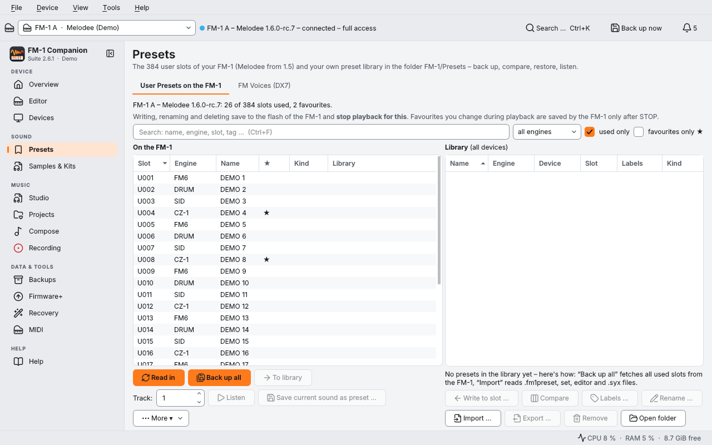

# FM-1 Companion Suite 2.6.1

The unofficial desktop suite for the **M-VAVE FM-1** pocket synthesizer: backups, firmware install and recovery,
a Studio that runs your firmware on the computer, presets, samples and MIDI tools – for Linux, built for the
Raspberry Pi 5.



> [!WARNING]
> **Unofficial community project – not affiliated with M-VAVE. No warranty (GPL-3.0, sections 15 and 16).**
> Installing or switching firmware, recovery, cleaning up leftovers, writing back from the Studio and restoring
> backups, presets or projects to the device change your FM-1 and are done **at your own risk** – make a backup first.
> Almost all of this has only run against simulations. On real hardware so far: one Melodee update, backups, MIDI
> and the basics of the Studio, on a single device. The honest list: [docs/UNTESTED.md](docs/UNTESTED.md).

Languages: English, German, Spanish – [help translate](docs/TRANSLATING.md).

## Install

**From source** (Raspberry Pi OS / Debian Bookworm or Trixie, Ubuntu):

```bash
git clone --depth 1 https://github.com/bit-wmike/fm1-companion.git
cd fm1-companion
./install.sh
```

`install.sh` checks the system packages and installs missing ones (asks for sudo; `--no-apt` skips that), installs
the app for your user and adds a start menu entry. Update later with `git pull && ./install.sh` – your settings and
`~/FM-1` are kept. Remove with `./uninstall.sh` (`--all` also removes settings and internal data) or
start menu › "Uninstall FM-1 Companion".

**Packages (.deb / .run)** are attached to each release on the
[Releases page](https://github.com/bit-wmike/fm1-companion/releases). The newest release may be older than this
source – its version is in the file names:

```bash
sudo apt install ./fm1-companion_<version>_all.deb     # Debian, Raspberry Pi OS, Ubuntu
sh FM-1-Companion-Suite-<version>.run                  # graphical installer
```

What changed in each version is in the release notes on that page.

<details>
<summary>More about installing: switches, FluidSynth, USB hubs, building the packages yourself</summary>

* More switches of `install.sh`: `--desktop` (shortcut on the desktop), `--no-fluidsynth-fix`, `--usb-power-rule`;
  `./install.sh --help` lists all of them. An unknown option stops the script before anything happens.
* **FluidSynth:** if Debian's FluidSynth user service (`fluidsynth.service`) is active, it grabs the first sound card
  at every login (on the Pi: HDMI). The installer then disables it and says so clearly (FluidSynth stays installed,
  the app starts it itself); with `--no-fluidsynth-fix` it is left unchanged. The graphical installer asks with a
  checkbox.
* **USB hubs:** flashing through a USB hub uses a *careful mode* (switched on automatically when the app sees a hub
  between the computer and the FM-1, or always via Settings › General): slower pacing, longer waits for the
  restarts, automatic resume of an interrupted write on the same device, and a flight log for the bug report.
  Linux' USB autosuspend can send the FM-1 or the hub to sleep during the restarts –
  `./install.sh --usb-power-rule` installs a udev rule that keeps them awake (the graphical installer offers it as
  a checkbox). Not tested on a real FM-1 yet.
* **Build the packages yourself** (result in `dist/`; the same commit always gives the same files):

  ```bash
  python3 tools/build_deb.py        # dist/fm1-companion_<version>_all.deb
  python3 tools/build_run.py        # dist/FM-1-Companion-Suite-<version>.run
  ```

* The `.run` installer is a graphical assistant (licence, notice, just for me or for all users, start menu, desktop
  shortcut, example samples); without a window:
  `sh FM-1-Companion-Suite-<version>.run --unattended [--prefix DIR] [--no-deps]`.

</details>

## Try it without a device

```bash
fm1-companion --demo          # from the source folder: python3 -m fm1companion --demo
```

starts with three simulated FM-1: one with Melodee 1.6.0-rc.7, one with SLOOP 2.8.5 and one with a firmware that
has no editor protocol. Demo mode uses its own settings; your data stays untouched.
More switches: `--check` (are all system packages there?), `--syscheck` (system check in the terminal),
`--lang LANG`, `--no-splash`, `--debug`, `--version`.

## What's inside

Section names as shown in the app's sidebar.

| Section | What it does |
|---|---|
| **Overview** | the active FM-1 at a glance: backup, firmware and updates, load, memory, projects, presets |
| **Editor** | the web editor of the installed firmware, embedded and offline |
| **Devices** | several FM-1 with their own profiles and firmware history; copy from device to device |
| **Presets**, **Samples & Kits** | all 384 user presets, your own library, FM voices (DX7); samples and kits, also on the FM-1 |
| **Studio** | the digital twin: your firmware's own code on the computer, with the device state from a backup (see below) |
| **Projects**, **Compose**, **Recording** | view patterns and songs, export MIDI, play on the FM-1; generate parts; record with Audacity |
| **Backups** | full backups, look inside, compare, restore the whole or only parts |
| **MIDI** | monitor, keyboard, clock, controls, connections, sound module |
| **Firmware+** | catalog of 250+ community firmwares (search, try in the simulator) and "Install & Versions": install, update, switch, back to the original |
| **Recovery** | update mode, finish an interrupted installation, "Is my FM-1 clean?", ROM boot mode |
| **Help** | help center (offline), FAQ, diagnostics, system check for USB, power and audio |
| **Settings › Storage** | what the app keeps (logs, downloads, caches), delete per category, automatic cleanup – never your own data in `~/FM-1` |

Around it: light/dark theme, command search (**Ctrl+K**), notifications with history, a setup assistant, and a small
computer indicator (CPU, RAM, temperature, free space) that opens the system check.

Firmware installs: built in are Melodee, Skiff, SLOOP and KARMA; others come from the catalog or your own `.fwsc`
file. A switch to another firmware always installs the original V15 first; an update within the same firmware goes
directly.

### Studio twins

The Studio runs the firmware itself, compiled for the computer – not an imitation. You can play it on screen, with
the computer keyboard or a MIDI keyboard, play projects, export WAV (24 bit or 32 bit float, optionally separate
tracks), take snapshots with undo and write back to the FM-1 with a safety backup first.

| Firmware | Bundled versions |
|---|---|
| Melodee | 1.6.1, 1.6.0, 1.6.0-rc.8, 1.6.0-rc.7 |
| Skiff | 2.2, 2.1.1 |
| SLOOP | 2.8.5, 2.8.4 |
| JIANT FM | V10.6z2, V10.61, V10.60 |
| KARMA | 3.1, 3.0.5 |
| CoralFlower | 0.7.1, 0.7 |
| ChoralRoot FM-1 | 0.39, 0.38 |
| Felucca | 1.8.1, 1.8.0 |
| X0X | 1.2.1, 1.2.0 |
| FoMni | 0.4.1, 0.4 |
| AMB-1 | 1.3.2, 1.3.1 |
| LOOM-8 | 0.14, 0.13.1 |
| M-VAVE FM1 Open | V14 – also the stand-in for the original V15/V16, with a note that they differ |

FoMni and AMB-1 have no backup over USB: their twins play and export, but cannot load from or write back to the
device. Only the Melodee twin has been used next to a real FM-1 so far; the other twelve have only been checked
against themselves and the app's own code.

<details>
<summary>More screenshots</summary>

Taken in demo mode, English UI.

| | |
|---|---|
|  |  |
| **Studio** with another firmware – here SLOOP 2.8.5 | **Overview** – device, backup, firmware & updates, quick access |
|  |  |
| **Projects › View & Export** – patterns, songs, MIDI export, play on the FM-1 | **Compose** – generate parts, preview with the FM-1's own sounds, undo |
|  |  |
| **Backups › Browse & Compare** – projects, presets, settings; restore only parts | **Firmware+** – 250+ community firmwares, install, versions, simulator |
|  |  |
| **Presets** – all 384 user slots, library, FM voices (DX7) | **Recovery** – update mode and ROM boot mode, with safety checks |
|  | |
| **Settings › Storage** – what the app keeps, delete per category, automatic cleanup | |

</details>

## Requirements

Linux with Python ≥ 3.11 and Qt 6.4 or newer – Raspberry Pi OS / Debian Bookworm and Trixie, current Ubuntu.
`install.sh` and the packages take care of this list:

* Required: `python3`, `python3-pyqt6`, `python3-pyqt6.qtsvg`, `python3-pyqt6.qtwebengine`,
  `python3-pyqt6.qtwebchannel`, `python3-mido`, `python3-rtmidi`, `python3-numpy`, `git`, and
  `qt6-translations-l10n` (Qt's own dialogs in your language – the app also starts without it).
* Recommended: `python3-pyqt6.qtmultimedia`, `ffmpeg`, `alsa-utils`, `pipewire-bin`, `audacity`, `fluidsynth`,
  `fluid-soundfont-gm`.

The list lives in one place, `fm1companion/data/deps.json`; `fm1-companion --check` shows what is missing.
The launcher always uses `/usr/bin/python3` – even if a venv is active.

## Privacy

No telemetry, no accounts. The app makes two automatic requests, and both can be switched off: when an FM-1 is
plugged in, it asks GitHub for the versions of its firmware; when the catalog is opened, it loads the awesome-fm-1
catalog including thumbnails. Everything else happens only when you click.

* **Switch off:** Settings › "look for firmware updates when an FM-1 is plugged in (asks GitHub)"; in the
  catalog (Firmware+ › "More") "Update the catalog automatically when opening" and "Load preview images from the
  internet". Or start with `FM1C_NO_NET=1 fm1-companion`: no automatic request at all; the catalog then uses the
  bundled data. What you start yourself (a download, "Reload") still goes to the network.
* **Bug reports** (Help › Diagnostics › "Save bug report …") are a ZIP file on your computer. Nothing is ever sent
  by the app. Credentials, your home folder, user and computer name, device names, notes, serial numbers (except
  the last four characters), MAC addresses and Wi-Fi names are removed. File names and other details can remain –
  look through it before you post it.
* An optional **GitHub token** (catalog › "More" › "GitHub token …") is stored in `config.json`, readable only by
  your user (0600).

## Security

* **Risk notice:** before the first firmware installation, recovery or ROM action the app shows a notice once
  ("I understand"). The confirmation of each single action remains; the installation plan and the recovery
  confirmations also say whether that kind of step has ever run on a real FM-1.
* **Web pages** (online editors and simulators from the catalog) are other people's pages. The app checks every MIDI
  message a page sends. Without your consent a page can only send notes, controllers and clock. An online editor
  gets editor commands (SysEx) only after you allow its address – only `https://` addresses (or pages on this
  computer) can be allowed, and the permission ends when the page moves to another address. Firmware-update and
  boot-mode commands are blocked from every web page, always. Files from web pages are saved only through the normal
  "Save" dialog.
* **Tools from firmware repos:** for "Rewrite font & factory sounds" the app runs the firmware's Python tool from
  its repository. For built-in firmwares the commit is pinned per version – if a tag later points to a different
  commit, the app asks. For firmwares you added yourself it asks before running each commit for the first time.
* Details and known limits: [SECURITY.md](SECURITY.md) – please report vulnerabilities privately as described
  there.

## Where things are

```
~/FM-1/                                   your data (NEVER deleted automatically)
  Backups/<device>/  Projekte/  Samples/  Kits/  Aufnahmen/  Firmware/
~/.config/fm1-companion/config.json       settings
~/.local/share/fm1-companion/             device profiles, tool repos, editor copies (+ app/ for a per-user install)
~/.local/state/fm1-companion/logs/        logs
```

The folder names under `~/FM-1/` are German: Projekte = projects, Aufnahmen = recordings.

## Tests and contributing

```bash
QT_QPA_PLATFORM=offscreen python3 -m pytest tests/test_*.py fm1companion/vendor/unbricker/tests -q
QT_QPA_PLATFORM=offscreen tests/run_ui.sh                      # every UI script, one after the other
QT_QPA_PLATFORM=offscreen python3 tests/ui_flow_test.py        # or a single one
```

The same runs on GitHub for every pull request, on Debian Bookworm and Trixie.

The most valuable contribution is a **test report from a real FM-1** (issue form "Hardware test report").
[CONTRIBUTING.md](CONTRIBUTING.md) · [Code structure](docs/ARCHITECTURE.md) · [Translating](docs/TRANSLATING.md) ·
[Roadmap](docs/ROADMAP.md) · [Which firmware is backed up and installed how](docs/firmware-support.md) ·
[How a release is made](docs/RELEASING.md)

## Legal

* The FM-1 Companion Suite is an **unofficial** community project. It is not affiliated with M-VAVE or the
  developers of the supported firmwares and is neither supported nor reviewed by them.
* "M-VAVE", "FM-1" and other product and company names are trademarks of their respective owners. They are used
  here only descriptively, to say which device the software works with.
* The software is provided without any warranty; liability is excluded to the extent permitted by law
  (GNU GPL 3.0, sections 15 and 16). Use – in particular flashing – is at your own risk.
* The bundled simulators and Studio twins are **built from the source code of the firmware projects** listed
  below. Each build folder (`fm1companion/sims/*/`) has a `NOTICE` with the exact commit, the licence and the
  offer of the source code; the source archives of exactly these commits are attached to each release.

## Credits and licence

FM-1 Companion is GPL-3.0-only. It stands on the work of the people who write firmware and tools for the FM-1:

* **Firmware whose code runs in the Studio twins and simulators:** Melodee (Kerem Kiliç) · Felucca,
  Felucca-Engines and felucca-bsp (Leo Kuroshita / Hügelton Instruments) · Skiff (illuminus5) · SLOOP (isod89) ·
  JIANT FM (juanjiant-bit) · KARMA (Ariel Muchnik) · ChoralRoot FM-1 (Quixotic7) · CoralFlower (FicusFicusov) ·
  X0X, FoMni, AMB-1, LOOM-8 and fm1-base (Charles Vestal) · FM1 Open (M-VAVE).
* **SLOOP 3** (isod89, GPL-3.0; its web editor is bundled unchanged) · **m-bootloader** and **M-Flasher** (Julius
  Vitkauskas, MIT; not bundled).
* **Recovery tools:** MvaveFM1Unbricker (Michael P Jones, MIT; bundled unchanged) · FM-1 Transporter (kurogedelic,
  MIT; bundled as a prebuilt file together with pico-sdk, TinyUSB and Pico-PIO-USB) · jl-uboot-tool (kagaimiq, MIT;
  not bundled, downloaded on request).
* **Catalog and design:** awesome-fm-1 (cicloid, CC0-1.0) · Lucide icons (ISC).

The full list with licences, including the parts these projects build on: Help › About › "Credits & Licenses"
(`fm1companion/data/credits.json` and `fm1companion/data/credits.d/`).
