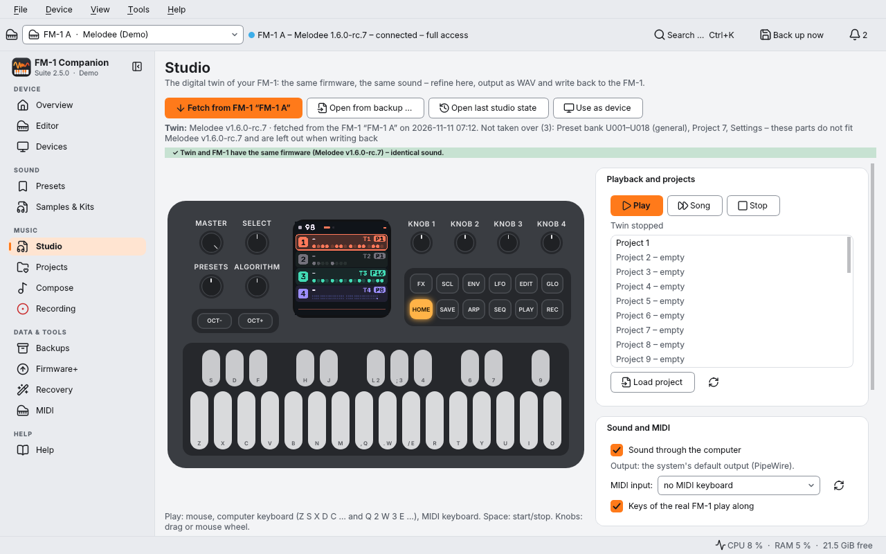
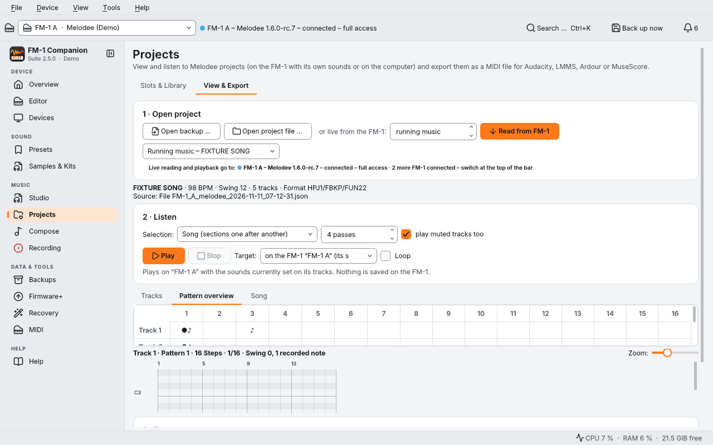
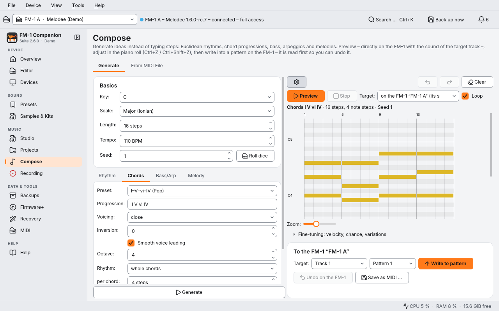
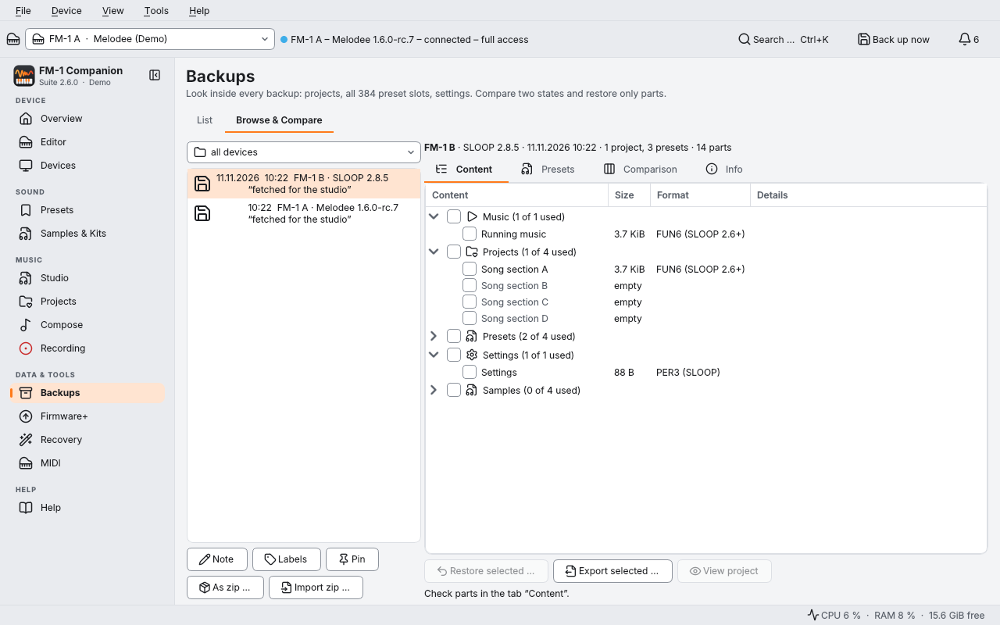
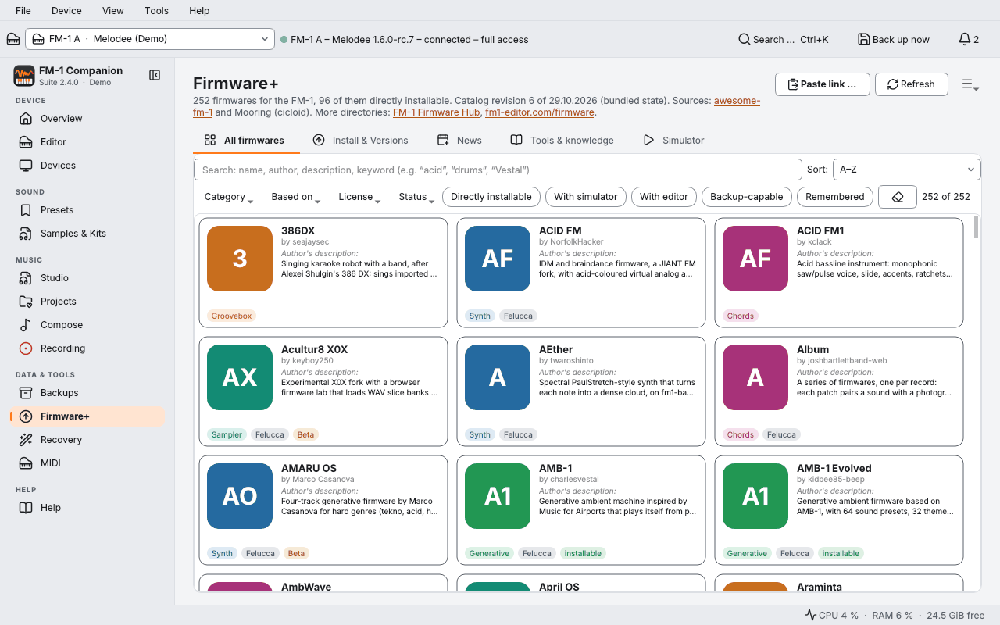
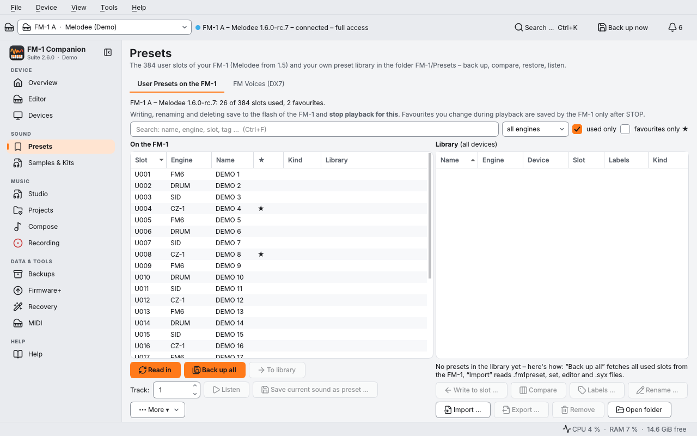
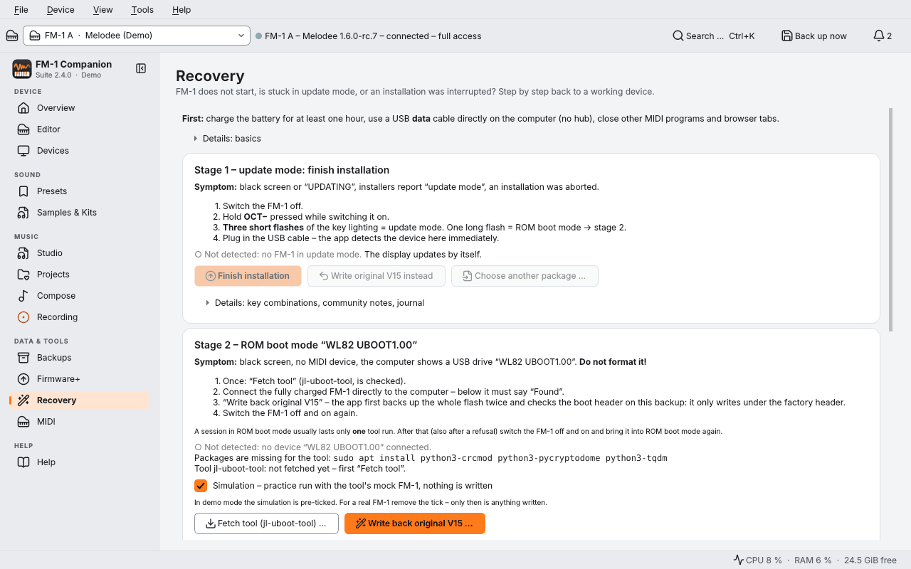

# FM-1 Companion Suite 2.4.0

> [!WARNING]
> **Unofficial community project – not affiliated with M-VAVE.**
> Installing firmware, rescue (update mode, ROM boot mode), "Is my FM-1 clean?" / clean up leftovers and writing
> back from the Studio change your device and are done **at your own risk**. Make a backup first.
>
> **These functions have not been tested on real hardware yet:** switching firmware, back to the original,
> rescue levels 1–3, clean up leftovers, the ROM check of "Is my FM-1 clean?" and writing back from the Studio.
> So far they have only run against simulations.
> Used on real hardware so far: one update **Melodee 1.6.0-rc.8 → 1.6.0** through the suite (it worked), backups,
> MIDI and the basic functions of the Studio – on a single device.
> The exact list: [docs/UNTESTED.md](docs/UNTESTED.md). No warranty (GPL-3.0, sections 15 and 16).

> [!NOTE]
> **Languages: English, German, Spanish** – help translate: [docs/TRANSLATING.md](docs/TRANSLATING.md).

The desktop suite for the **M-VAVE FM-1** with firmwares of the Felucca family (**Melodee**, **Skiff**, **SLOOP**)
and the official firmware. Everything around the device in one app – built for the Raspberry Pi 5
(Raspberry Pi OS Bookworm/Trixie, KDE Plasma), runs on any Debian/Ubuntu.



## Screenshots

Taken in demo mode (`fm1-companion --demo`, two simulated FM-1), English UI.

| | |
|---|---|
|  |  |
| **Projects › View & Export** – patterns, songs, MIDI export, play on the FM-1 | **Compose** – generate parts, preview with the FM-1's own sounds, undo |
|  |  |
| **Backups › Browse & Compare** – projects, presets, settings; restore only parts | **Firmware+** – 250+ community firmwares, install, versions, simulator |
|  |  |
| **Presets** – all 384 user slots, library, FM voices (DX7) | **Recovery** – update mode and ROM boot mode, with safety checks |

## What's inside

Section names as shown in the app's sidebar (Device, Sound, Music, Data & Tools, Help).

| Section | What it does |
|---|---|
| **Overview** | active device, backup, firmware & updates, quick access – tab "Status": live load, memory pool, projects, all 384 user presets |
| **Editor** | the original web editor of the installed firmware, embedded and offline |
| **Devices** | several FM-1 with their own profiles, firmware history, copy from device to device |
| **Presets**, **Samples & Kits** (Sound) | presets (with tab "FM Voices (DX7)"), samples & kits (with tab "On the FM-1") |
| **Studio** | the digital twin of your FM-1: the same firmware on the computer – Melodee (1.6.1, plus 1.6.0 and 1.6.0-rc.7/rc.8), Skiff (2.2, 2.1.1) or JIANT FM (V10.6z2, plus V10.61 and V10.60) –, with the complete device state from the backup – play on screen, with the computer keyboard or a MIDI keyboard, play projects, export as WAV (24 bit or 32 bit float, optionally separate tracks) for Logic/Audacity, snapshots with undo, write back to the FM-1 with a safety backup; also usable as a virtual device for projects, composing, presets and backups |
| **Projects**, **Compose**, **Recording** (Music) | projects (slots & library / view & export), composing (generate / from MIDI file), recording with Audacity |
| **Backups**, **MIDI** (Data & Tools) | backups (list / browse & compare), MIDI (monitor, keyboard, clock, controls, connections, sound module) |
| **Firmware+** | all firmwares in one place: catalog (search, view, try in the simulator, import links, news) and tab "Install & Versions" (versions from GitHub, install, switch, download several versions, your own .fwsc, back to the original, way back from V16) |
| **Recovery** | update mode, finish an interrupted installation, "Is my FM-1 clean?", rescue level 2 |
| **Help** | help center (offline), FAQ, diagnostics, system check |

Plus the frame: light/dark/automatic theme with accent colour, consistent icons, command search
(**Ctrl+K**), notifications with history, setup assistant, "What's new", crash dialog with error report and
a slim computer indicator at the bottom right (CPU, RAM, temperature, free space). Clicking it opens the
**system check**: it reads the kernel log and explains when the FM-1 keeps disconnecting,
the power supply is weak, USB audio reports errors or the Pi gets too hot.
The app itself shows which sections are included (sidebar, Help › What's new).

## Install

**From source:**

```bash
git clone https://github.com/bit-wmike/fm1-companion.git
cd fm1-companion
./install.sh
```

`install.sh` checks the system packages and installs missing ones (asks for sudo; `--no-apt` skips that),
installs the app for your user and adds a start menu entry. More switches: `--desktop`
(shortcut on the desktop), `--no-fluidsynth-fix` (see below). Remove: `./uninstall.sh`
(`--all` also removes settings and internal data) or start menu › "Uninstall FM-1 Companion".
Updates: `git pull && ./install.sh` – your settings and `~/FM-1` are kept.

If Debian's FluidSynth user service (`fluidsynth.service`) is active, it grabs the first sound card at every
login (on the Pi: HDMI). The installer then disables it and says so clearly (FluidSynth stays installed, the app
starts it itself); with `--no-fluidsynth-fix` it is left unchanged. The graphical installer asks with a
checkbox.

**Packages (.deb/.run):** version 2.4.0 is available under
[Releases](https://github.com/bit-wmike/fm1-companion/releases):

```bash
sudo apt install ./fm1-companion_2.4.0_all.deb
sh FM-1-Companion-Suite-2.4.0.run
```

You can also build them yourself (result in `dist/`):

```bash
python3 tools/build_deb.py        # dist/fm1-companion_2.4.0_all.deb  → sudo apt install ./dist/fm1-companion_2.4.0_all.deb
python3 tools/build_run.py        # dist/FM-1-Companion-Suite-2.4.0.run → sh dist/FM-1-Companion-Suite-2.4.0.run
```

The `.run` installer is a graphical assistant (licence, notice, just for me or for all users, start menu,
desktop shortcut, example samples); without a window:
`sh FM-1-Companion-Suite-2.4.0.run --unattended [--prefix DIR] [--no-deps]`.

## Requirements

Required: `python3` (≥ 3.11), `python3-pyqt6`, `python3-pyqt6.qtsvg`, `python3-pyqt6.qtwebengine`,
`python3-pyqt6.qtwebchannel`, `python3-mido`, `python3-rtmidi`, `python3-numpy`, `git`, `qt6-translations-l10n`.
Recommended: `python3-pyqt6.qtmultimedia`, `ffmpeg`, `alsa-utils`, `pipewire-bin`, `audacity`, `fluidsynth`,
`fluid-soundfont-gm`. The list lives in one place: `fm1companion/data/deps.json`.
Check: `fm1-companion --check`. The launcher always uses `/usr/bin/python3` – even if a venv is active.

## Try it without a device

`fm1-companion --demo` starts with two simulated FM-1 (Melodee 1.6 and SLOOP 2.8).
More switches: `--syscheck` (system check in the terminal), `--no-splash`, `--debug`, `--version`.

## Privacy

No telemetry, no accounts. The app only makes two automatic requests (both can be switched off): when an FM-1 is
plugged in, the list of versions of its firmware on GitHub, and when the catalog is opened, the awesome-fm-1
catalog including thumbnails. Everything else happens only when you click. Error reports are only stored locally.

* **Switch off:** Settings › "look for firmware updates when an FM-1 is plugged in (asks GitHub)"; in the
  catalog (Firmware+ › "More") "Update the catalog automatically when opening" and "Load preview images from the
  internet".
* **No automatic network access:** `FM1C_NO_NET=1 fm1-companion` switches off both automatic requests;
  the catalog and the link import then only work with the bundled data. What you start yourself (firmware or
  editor download, "Reload" of the version list) still goes to the network.
* **Error reports** (ZIP, Help › Diagnostics) contain logs, versions and settings – without
  personal paths, notes, host names, credentials (e.g. a GitHub token) and full serial numbers.
  Whether you share one is up to you; look at it first.
* An optional **GitHub token** (catalog › "More" › "GitHub token …") is stored in `config.json`, which is saved
  readable only by your user (0600).

## Security

* **Risk notice:** Before the first firmware installation, rescue or ROM action the app shows a notice once
  ("I understand"). The confirmations of each individual action remain.
* **Online editors** from the catalog are third-party web pages: editor commands (SysEx) reach the FM-1 only after
  your consent per address; if the page changes its address, the safe filter applies again (only notes,
  controllers, clock). Firmware update and boot mode are always blocked from web pages.
* **Tools from firmware repos:** For "Rewrite font & factory sounds" the app runs the firmware's
  Python tool from its repository. For built-in firmwares the commit is pinned per version – if a tag later points
  to a different commit, the app asks. For firmwares you added yourself it asks before running each commit for
  the first time (repo and commit are shown).
* Please report security vulnerabilities privately: [SECURITY.md](SECURITY.md).

## Where things are

```
~/FM-1/                                   your data (NEVER deleted automatically)
  Backups/<device>/  Projekte/  Samples/  Kits/  Aufnahmen/  Firmware/
~/.config/fm1-companion/config.json       settings
~/.local/share/fm1-companion/             device profiles, tool repos, editor copies (+ app/ for a per-user install)
~/.local/state/fm1-companion/logs/        logs
```

The folder names under `~/FM-1/` are German: Projekte = projects, Aufnahmen = recordings.

## Tests

```bash
QT_QPA_PLATFORM=offscreen python3 -m pytest tests/test_*.py fm1companion/vendor/unbricker/tests -q
QT_QPA_PLATFORM=offscreen python3 tests/ui_flow_test.py        # each tests/ui_*_test.py on its own
QT_QPA_PLATFORM=offscreen python3 tests/ui_smoke.py screenshots
```

Contributing: [CONTRIBUTING.md](CONTRIBUTING.md) · Code structure: [docs/ARCHITECTURE.md](docs/ARCHITECTURE.md) ·
Translations: [docs/TRANSLATING.md](docs/TRANSLATING.md).

## Legal

* The FM-1 Companion Suite is an **unofficial** community project. It is not affiliated with M-VAVE or the
  developers of the supported firmwares and is neither supported nor reviewed by them.
* "M-VAVE", "FM-1" and other product and company names are trademarks of their respective owners. They are used
  here only descriptively, to say which device the software works with.
* The software is provided without any warranty; liability is excluded to the extent permitted by law
  (GNU GPL 3.0, sections 15 and 16). Use – in particular flashing – is at your own risk.
* Bundled simulators are **built from the official source code** (M-VAVE FM1 Open) or from the firmware's source
  code (Melodee); attributions and the GPL offer are in `fm1companion/sims/*/NOTICE`.

## Credits and licence

GPL-3.0-only. Thanks to Melodee (Kerem Kiliç), Felucca (Leo Kuroshita / Hügelton
Instruments), Skiff (illuminus5), SLOOP (isod89), M-VAVE FM1 Open, awesome-fm-1 (cicloid, CC0-1.0) and Lucide (ISC).
Full list: Help › About › Credits & Licences (`fm1companion/data/credits.json`).
