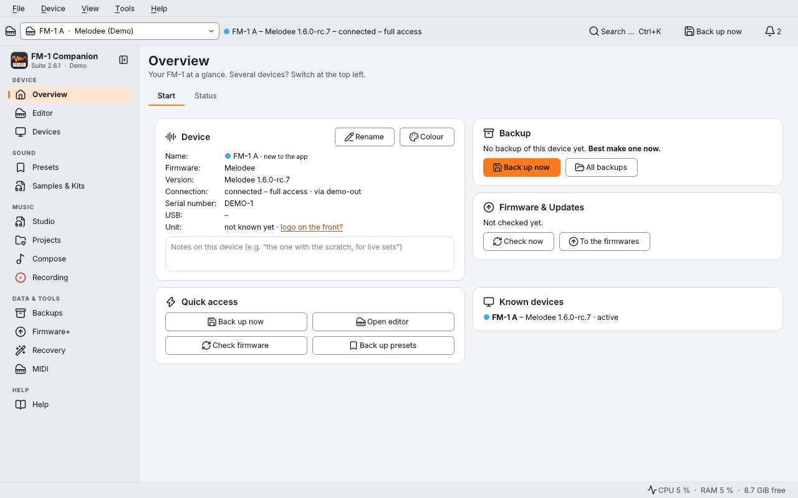
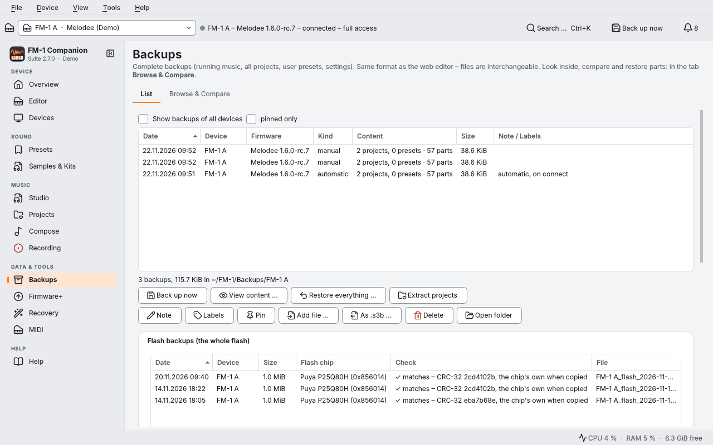
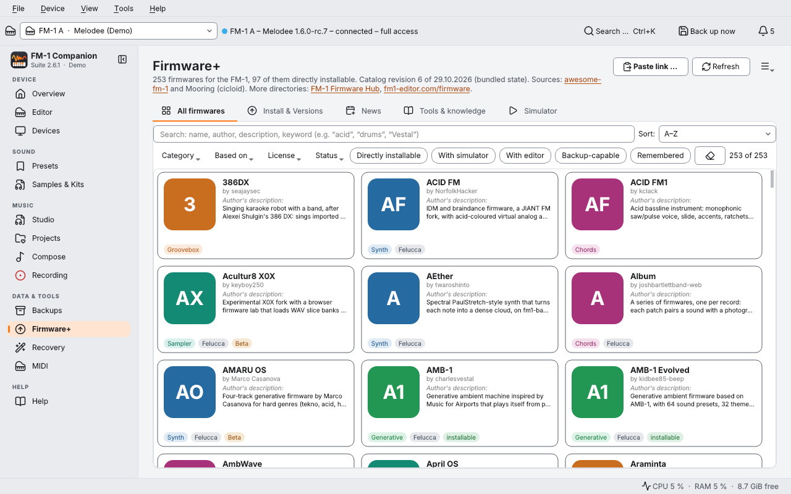
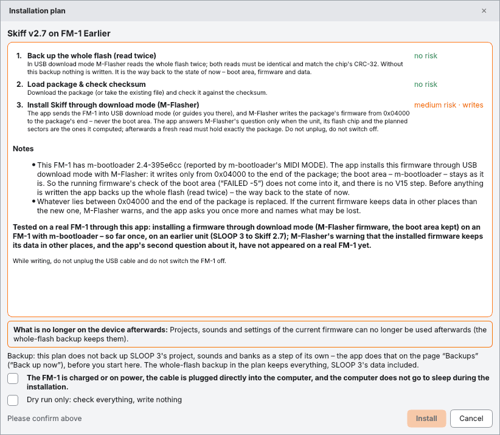
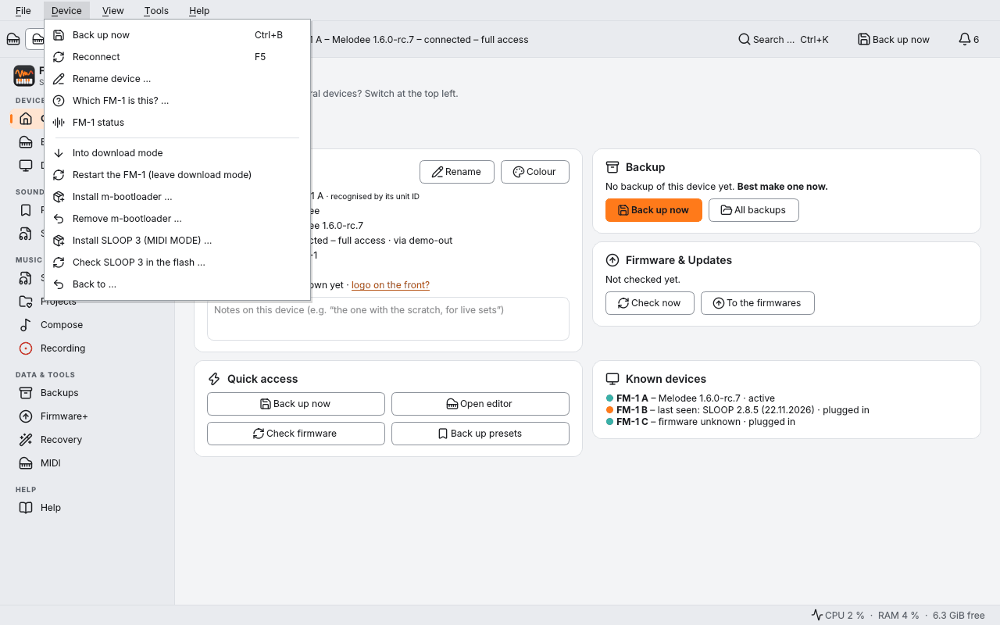
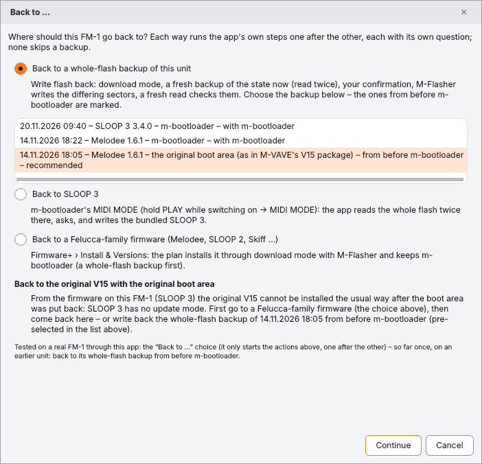
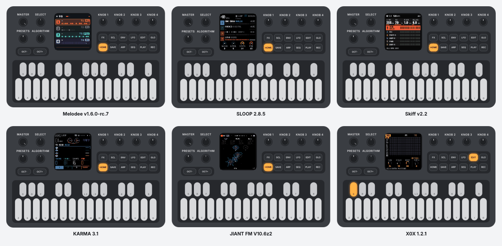
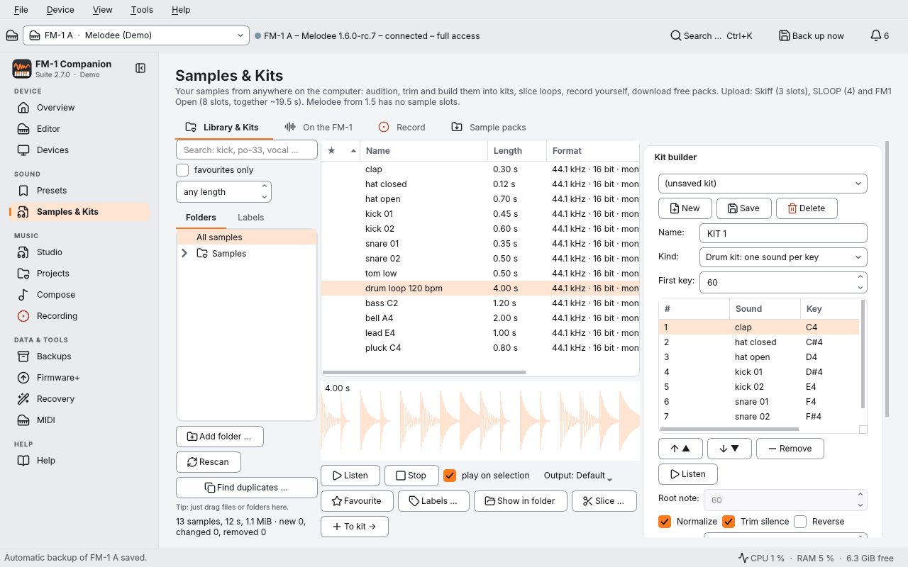
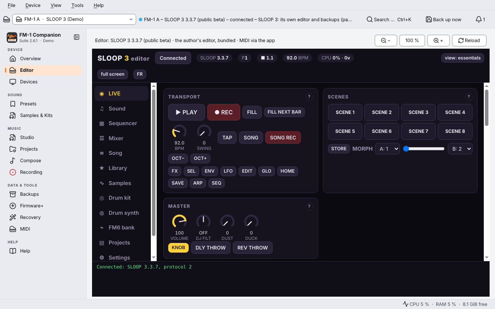

# FM-1 Companion Suite 2.7.0

The unofficial desktop suite for the **M-VAVE FM-1** pocket synthesizer: backups, firmware install and recovery,
a Studio that runs your firmware on the computer, presets, samples and MIDI tools – for Linux, built for the
Raspberry Pi 5.


See more: [a quick tour in pictures](#a-quick-tour) below, or [all 40 screenshots with explanations](docs/TOUR.md).

> [!WARNING]
> **Unofficial community project – not affiliated with M-VAVE. No warranty (GPL-3.0, sections 15 and 16).**
> Installing or switching firmware, recovery, cleaning up leftovers, writing back from the Studio and restoring
> backups, presets or projects to the device change your FM-1 and are done **at your own risk** – make a backup first.
> Almost all of this has only run against simulations. On real hardware so far – one Raspberry Pi 5 with Bookworm,
> two units, most of it once: an update within Melodee; a switch KARMA → original V15 → Skiff through two USB hubs;
> Skiff on a newer FM-1; backups of Melodee, KARMA, Skiff and SLOOP 3; SLOOP 3 and m-bootloader recognised; MIDI and
> the basics of the Studio; through the bundled tools on an earlier unit: whole-flash backups and write-backs,
> m-bootloader installed and removed, SLOOP 3 installed, Skiff through download mode, "Back to …" a backup. **Not tested:** restoring a backup, writing back from the Studio, writing in recovery,
> anything else on a newer FM-1. The honest list: [docs/UNTESTED.md](docs/UNTESTED.md).

Languages: English, German, Spanish – [help translate](docs/TRANSLATING.md).

## Install

**From source** (Raspberry Pi OS / Debian Bookworm or Trixie, Ubuntu):

```bash
git clone --depth 1 https://github.com/bit-wmike/fm1-companion.git
cd fm1-companion
./install.sh
```

`install.sh` checks the system packages and installs missing ones (asks for sudo; `--no-apt` skips that), installs
the app for your user and adds a start menu entry. Update later with `git pull && ./install.sh` – your settings and
`~/FM-1` are kept. Remove with `./uninstall.sh` (`--all` also removes settings and internal data) or
start menu › "Uninstall FM-1 Companion".

**Packages (.deb / .run)** are attached to each release on the
[Releases page](https://github.com/bit-wmike/fm1-companion/releases). The newest release may be older than this
source – its version is in the file names:

```bash
sudo apt install ./fm1-companion_<version>_all.deb     # Debian, Raspberry Pi OS, Ubuntu
sh FM-1-Companion-Suite-<version>.run                  # graphical installer
```

What changed in each version is in the release notes on that page.

<details>
<summary>More about installing: switches, FluidSynth, USB hubs, building the packages yourself</summary>

* More switches of `install.sh`: `--desktop` (shortcut on the desktop), `--no-fluidsynth-fix`, `--usb-power-rule`,
  `--no-download-mode-rule`; `./install.sh --help` lists all of them. An unknown option stops the script before
  anything happens.
* **Download mode without a password:** `install.sh` installs by default a udev rule for the FM-1 in ROM download mode
  (USB 4c4a:8057) and loads the `sg` driver at boot, so the app's flash backup through M-Flasher needs no
  administrator password. It uses `sudo -n` where that works without a password, else sudo in a terminal, else
  pkexec in a desktop session; otherwise it prints the exact commands. `--no-download-mode-rule` leaves it out.
* **FluidSynth:** if Debian's FluidSynth user service (`fluidsynth.service`) is enabled, it grabs the first sound card
  at every login (on the Pi: HDMI). A "just for me" installation then switches it off for your user and says so
  (FluidSynth stays installed, the app starts it itself): it disables the service, or – when it is enabled for all
  users, where disabling changes nothing – stops and masks it for your user. Uninstalling the app takes that mask
  away again. With `--no-fluidsynth-fix` it is left unchanged; the graphical installer asks with a checkbox.
* **USB hubs:** flashing through a USB hub uses a *careful mode* (switched on automatically when the app sees a hub
  between the computer and the FM-1, or always via Settings › General): slower pacing, longer waits for the
  restarts, automatic resume of an interrupted write on the same device, and a flight log for the bug report.
  Linux' USB autosuspend can send the FM-1 or the hub to sleep during the restarts –
  `./install.sh --usb-power-rule` installs a udev rule that keeps them awake (the graphical installer offers it as
  a checkbox). A firmware switch through two self-powered hubs ran once on a real FM-1 in careful mode, without a
  dropout – the automatic resume has only run in the simulation.
* **Recovery tool:** the packages it needs (`python3-crcmod`, `python3-yaml`) are installed by default, so that the
  recovery is ready before it is needed.
* **Build the packages yourself** (result in `dist/`; the same commit always gives the same files):

  ```bash
  python3 tools/build_deb.py        # dist/fm1-companion_<version>_all.deb
  python3 tools/build_run.py        # dist/FM-1-Companion-Suite-<version>.run
  ```

* The `.run` installer is a graphical assistant (licence, notice, just for me or for all users, start menu, desktop
  shortcut, example samples); without a window:
  `sh FM-1-Companion-Suite-<version>.run --unattended [--prefix DIR] [--no-deps]`.

</details>

## Newer FM-1 (logo on the front)

FM-1 sold from late 2026 have the M-VAVE logo printed on the front and a different flash chip (UCUN UC25HQ80).
Firmware versions written before that save nothing on such a unit, and most of them can then no longer be updated.
What the app does:

* It has a table of the first version of each firmware that knows the chip, each with its source
  ([`hardware.json`](fm1companion/data/hardware.json)) – for example Melodee 1.6.0, Skiff 2.2, SLOOP 2.8.5,
  KARMA 3.0.4, JIANT FM V10.6z, Felucca 1.8.2. A firmware it knows nothing about counts as not supported.
* It asks once per device whether your FM-1 has the logo on the front, or reads the chip itself (in ROM boot mode,
  and in m-bootloader's MIDI MODE).
* On a newer unit it never installs a firmware version without support for the chip. The bundled recovery tool knows
  both chips.

Only one of these firmwares has run on such a unit with this app: Skiff 2.7, installed once on one unit. More:
[help page "Switching firmware"](fm1companion/data/help/en/02-firmware.md#newer-fm-1-logo-on-the-front).

## Try it without a device

```bash
fm1-companion --demo          # from the source folder: python3 -m fm1companion --demo
```

starts with three simulated FM-1: one with Melodee 1.6.0-rc.7, one with SLOOP 2.8.5 and one with a firmware that
has no editor protocol (shown as ORBIT). Installing and recovery run against simulated devices there too. Demo mode
uses its own settings; your data stays untouched.
More switches: `--check` (are all system packages there?), `--syscheck` (system check in the terminal),
`--lang LANG`, `--no-splash`, `--debug`, `--version`.

## A quick tour

Nine pictures of what the app looks like; the [full tour](docs/TOUR.md) has forty, grouped by topic. All of them were
taken in **demo mode** (English interface) with the simulated FM-1 – no real device, no real device data. The two
dialogs of the bundled tools were opened for the picture with a made-up unit ("FM-1 Earlier"); nothing was written.

**Overview** – the first page: which FM-1 is connected, its firmware, whether there is a backup, and the most used
actions as buttons. The list on the left is the whole app.



**Backups** – every backup of your FM-1 with date and content; look inside, compare, restore the whole or only
parts. Below them the flash backups: copies of the whole memory chip, made with M-Flasher (the three in the picture
are a test image).



**Firmware+** – a catalog of 250+ community firmwares with search and filters; one click shows what a firmware is
and what the app can do with it.



**The installation plan** – before anything is installed you see every step with its risk, what will be gone
afterwards and, in bold, whether this kind of installation has ever run on a real FM-1. Nothing starts before you
tick the confirmation.



**The Device menu** – a backup, reconnecting, and the bundled tools: download mode, m-bootloader, SLOOP 3 and
"Back to …" (the same buttons are on Recovery › Tools).



**"Back to …"** – one button for the way back. The app lists this unit's whole-flash backups, marks which are from
before m-bootloader and which are with it, and pre-selects the newest one from before; the other ways are offered
with their steps or with the reason why one is not possible right now.



**Studio twins** – the Studio runs the firmware's own code on the computer. Six of the thirteen twins side by side,
each with its firmware's display (next to a real FM-1 only the Melodee twin has been used, and the Skiff twin once).



**Samples & Kits** – your sample library with a waveform preview and the kit builder: put sounds on keys and upload
the kit to an FM-1 whose firmware has sample slots. (The sounds here were generated for the picture.)



**Editor with SLOOP 3** – when the app recognises SLOOP 3, the Editor page shows SLOOP 3's own editor, bundled
unchanged (here SLOOP 3 3.3.7 against the test stand-in, not a real FM-1).



More: [the full tour](docs/TOUR.md) – presets, projects, Compose, recording, the simulator, the questions before
every write, MIDI, recovery, settings and help.

## What's inside

Section names as shown in the app's sidebar.

| Section | What it does |
|---|---|
| **Overview** | the active FM-1 at a glance: backup, firmware and updates, load, memory, projects, presets |
| **Editor** | the web editor of the installed firmware, embedded and offline – for SLOOP 3 its own bundled editor |
| **Devices** | several FM-1 with their own profiles and firmware history; copy from device to device |
| **Presets**, **Samples & Kits** | all 384 user presets, your own library, FM voices (DX7); samples and kits, also on the FM-1 |
| **Studio** | the digital twin: your firmware's own code on the computer, with the device state from a backup (see below) |
| **Projects**, **Compose**, **Recording** | view patterns and songs, export MIDI, play on the FM-1; generate parts; record with Audacity |
| **Backups** | full backups, look inside, compare, restore the whole or only parts; SLOOP 3 backups of its own kind |
| **MIDI** | monitor, keyboard, clock, controls, connections, sound module |
| **Firmware+** | catalog of 250+ community firmwares (search, try in the simulator) and "Install & Versions": install, update, switch, back to the original; SLOOP 3: the way to install it, and a copy of the whole flash in m-bootloader's MIDI MODE |
| **Recovery** | update mode, finish an interrupted installation, "Is my FM-1 clean?", ROM boot mode |
| **Help** | help center (offline), FAQ, diagnostics, system check for USB, power and audio |
| **Settings › Storage** | what the app keeps (logs, downloads, caches), delete per category, automatic cleanup – never your own data in `~/FM-1` |

Around it: light/dark theme, command search (**Ctrl+K**), notifications with history, a setup assistant, and a small
computer indicator (CPU, RAM, temperature, free space) that opens the system check.

Several FM-1: the app tells them apart by their unit ID when the firmware shows one (the original firmware,
m-bootloader's MIDI MODE). Skiff, Melodee, SLOOP and the other Felucca firmwares show none – then the app asks
"Which FM-1 is this?" at every plug-in, never guesses by USB port, and names the unit before every write so you can
check it.

Firmware installs: built in are Melodee, Skiff, SLOOP and KARMA; others come from the catalog or your own `.fwsc`
file. SLOOP 3 is built in too and goes on over m-bootloader (see below). A switch to another firmware installs the
original V15 first – except on an FM-1 with m-bootloader, where it goes through download mode (below); an update
within the same firmware goes directly.

### M-Flasher, m-bootloader and SLOOP 3 – bundled and driven

The suite brings three tools along, pinned and checked by SHA-256, and drives them with its own buttons (Recovery ›
Tools, the Device menu, Backups › Flash backups): **M-Flasher** 0.12.1 (Julius Vitkauskas, MIT; 64-bit ARM and
x86-64), **m-bootloader** 2.4 and the **SLOOP 3** 3.4.0 application area (isod89, GPL-3.0). It does not replace them:
M-Flasher does every write in USB download mode, m-bootloader every write in its MIDI MODE; the app checks before and
after.

* **Back up the whole flash** (read twice, checked against the chip's CRC-32), **write it back** (only onto the unit
  it came from, by unit ID and flash chip), **import** M-Flasher's own dumps, **into download mode / restart**.
* **Install / remove m-bootloader** (only the boot area 0x00000–0x03FFF; removal puts back M-VAVE's V15 boot area, on
  an earlier unit only).
* **Firmware through download mode:** on an FM-1 with m-bootloader – also from a running SLOOP 3 – a Felucca-family
  firmware goes on with M-Flasher from 0x04000 to the package's end; the boot area stays, so there is no CHECK HEAD
  trap and no V15 step. The installation plan offers this route by itself.
* **Install SLOOP 3** over m-bootloader's MIDI MODE, offline, with the package built byte for byte as the author's
  installer page builds it; without m-bootloader its first step is installing it.
* **Back to …:** one button for the way back – a whole-flash backup of this unit (those from before m-bootloader
  marked, the newest of them pre-selected), SLOOP 3, a Felucca-family firmware or the original V15 – that only starts
  the steps above, each with its own question.

Every write: a whole-flash backup first (never skipped), a danger question naming the unit, its unit ID and revision,
the app's own check of exactly the sectors that will be written right before M-Flasher's "yes" (the app never passes
`--yes`), a record on disk and no quitting while it writes, a fresh read afterwards. On real hardware through the
app, on an earlier unit, mostly once or twice: backups, write-backs (also of the whole boot area), m-bootloader
install and removal, the SLOOP 3 install with its check, Skiff through download mode from SLOOP 3, "Back to …" a
backup from before m-bootloader – each byte-identical where it was compared. On a newer unit only backups and an
import; nothing written there yet. The full list: [docs/UNTESTED.md](docs/UNTESTED.md). Details: [docs/flash-protocol.md §16](docs/flash-protocol.md).

### SLOOP 3 and m-bootloader

SLOOP 3 (isod89) is a rewrite of SLOOP and a **public beta**. It installs only through m-bootloader's MIDI MODE: the
app does that itself (see above), or the author's installer page does. What else the app does:

* It recognises SLOOP 3 and shows its own web editor on the Editor page – bundled unchanged for 3.3.7 and 3.4.0, so
  it works offline.
* Backups of the project, sounds, banks and settings, and their restore (samples are not in such a backup).
* It recognises m-bootloader's MIDI MODE and never takes it for an update mode; there it can copy the whole flash
  (read only, checked against the chip's own checksum).
* From a running SLOOP 3 it installs a Felucca-family firmware through download mode (above); on a newer FM-1 (logo
  on the front) SLOOP 3 only with the builds the hardware table lets through. The Studio has no SLOOP 3 twin.

On a real FM-1: recognition, the bundled editor connected, backups, MIDI MODE recognised, and – on an earlier unit,
twice – the app's own SLOOP 3 install with its check read. SLOOP 3's first start sets up its own storage: the old
firmware's presets and projects on the FM-1 are gone afterwards (the app says so and offers a backup first). Restore
of a SLOOP 3 backup has only run against stand-ins. More: [help page "SLOOP 3"](fm1companion/data/help/en/15-sloop3.md).

### Studio twins

The Studio runs the firmware itself, compiled for the computer – not an imitation. You can play it on screen, with
the computer keyboard or a MIDI keyboard, play projects, export WAV (24 bit or 32 bit float, optionally separate
tracks), take snapshots with undo and write back to the FM-1 with a safety backup first.

| Firmware | Bundled versions |
|---|---|
| Melodee | 1.6.1, 1.6.0, 1.6.0-rc.8, 1.6.0-rc.7 |
| Skiff | 2.2, 2.1.1 |
| SLOOP | 2.8.5, 2.8.4 |
| JIANT FM | V10.6z2, V10.61, V10.60 |
| KARMA | 3.1, 3.0.5 |
| CoralFlower | 0.7.1, 0.7 |
| ChoralRoot FM-1 | 0.39, 0.38 |
| Felucca | 1.8.1, 1.8.0 |
| X0X | 1.2.1, 1.2.0 |
| FoMni | 0.4.1, 0.4 |
| AMB-1 | 1.3.2, 1.3.1 |
| LOOM-8 | 0.14, 0.13.1 |
| M-VAVE FM1 Open | V14 – also the stand-in for the original V15/V16, with a note that they differ |

FoMni and AMB-1 have no backup over USB: their twins play and export, but cannot load from or write back to the
device. Only the Melodee twin has been used next to a real FM-1, and the Skiff twin once (fetched from a unit with
Skiff 2.7); the other eleven have only been checked against themselves and the app's own code.

More pictures of the Studio and of everything else: [docs/TOUR.md](docs/TOUR.md).

## Requirements

Linux with Python ≥ 3.11 and Qt 6.4 or newer – Raspberry Pi OS / Debian Bookworm and Trixie, current Ubuntu.
`install.sh` and the packages take care of this list:

* Required: `python3`, `python3-pyqt6`, `python3-pyqt6.qtsvg`, `python3-pyqt6.qtwebengine`,
  `python3-pyqt6.qtwebchannel`, `python3-mido`, `python3-rtmidi`, `python3-numpy`, `git`, and
  `qt6-translations-l10n` (Qt's own dialogs in your language – the app also starts without it).
* Recommended: `python3-pyqt6.qtmultimedia`, `ffmpeg`, `alsa-utils`, `pipewire-bin`, `audacity`, `fluidsynth`,
  `fluid-soundfont-gm`, and `python3-crcmod`, `python3-yaml` for the recovery tool.

The list lives in one place, `fm1companion/data/deps.json`; `fm1-companion --check` shows what is missing.
The launcher always uses `/usr/bin/python3` – even if a venv is active.

## Privacy

No telemetry, no accounts. The app makes two automatic requests, and both can be switched off: when an FM-1 is
plugged in, it asks GitHub for the versions of its firmware; when the catalog is opened, it loads the awesome-fm-1
catalog including thumbnails. Everything else happens only when you click.

* **Switch off:** Settings › "look for firmware updates when an FM-1 is plugged in (asks GitHub)"; in the
  catalog (Firmware+ › "More") "Update the catalog automatically when opening" and "Load preview images from the
  internet". Or start with `FM1C_NO_NET=1 fm1-companion`: no automatic request at all; the catalog then uses the
  bundled data. What you start yourself (a download, "Reload") still goes to the network.
* **Bug reports** (Help › Diagnostics › "Save bug report …") are a ZIP file on your computer. Nothing is ever sent
  by the app. Credentials, your home folder, user and computer name, device names, notes, serial numbers (except
  the last four characters), MAC addresses and Wi-Fi names are removed. File names and other details can remain –
  look through it before you post it.
* An optional **GitHub token** (catalog › "More" › "GitHub token …") is stored in `config.json`, readable only by
  your user (0600).

## Security

* **Risk notice:** before the first firmware installation, recovery or ROM action the app shows a notice once
  ("I understand"). The confirmation of each single action remains; the installation plan and the recovery
  confirmations also say whether that kind of step has ever run on a real FM-1.
* **Web pages** (online editors and simulators from the catalog) are other people's pages. The app checks every MIDI
  message a page sends. Without your consent a page can only send notes, controllers and clock. An online editor
  gets editor commands (SysEx) only after you allow its address – only `https://` addresses (or pages on this
  computer) can be allowed, and the permission ends when the page moves to another address. Firmware-update and
  boot-mode commands are blocked from every web page, always. Files from web pages are saved only through the normal
  "Save" dialog.
* **Tools from firmware repos:** for "Rewrite font & factory sounds" the app runs the firmware's Python tool from
  its repository. For built-in firmwares the commit is pinned per version – if a tag later points to a different
  commit, the app asks. For firmwares you added yourself it asks before running each commit for the first time.
* Details and known limits: [SECURITY.md](SECURITY.md) – please report vulnerabilities privately as described
  there.

## Where things are

```
~/FM-1/                                   your data (NEVER deleted automatically)
  Backups/<device>/  Projekte/  Samples/  Kits/  Aufnahmen/  Firmware/
~/.config/fm1-companion/config.json       settings
~/.local/share/fm1-companion/             device profiles, tool repos, editor copies (+ app/ for a per-user install)
~/.local/state/fm1-companion/logs/        logs
```

The folder names under `~/FM-1/` are German: Projekte = projects, Aufnahmen = recordings.

## Tests and contributing

```bash
QT_QPA_PLATFORM=offscreen python3 -m pytest tests/test_*.py fm1companion/vendor/unbricker/tests -q
QT_QPA_PLATFORM=offscreen tests/run_ui.sh                      # every UI script, one after the other
QT_QPA_PLATFORM=offscreen python3 tests/ui_flow_test.py        # or a single one
```

The same runs on GitHub for every pull request, on Debian Bookworm and Trixie.

The most valuable contribution is a **test report from a real FM-1** (issue form "Hardware test report").
[CONTRIBUTING.md](CONTRIBUTING.md) · [Code structure](docs/ARCHITECTURE.md) · [Translating](docs/TRANSLATING.md) ·
[Roadmap](docs/ROADMAP.md) · [Which firmware is backed up and installed how](docs/firmware-support.md) ·
[How a release is made](docs/RELEASING.md)

## Legal

* The FM-1 Companion Suite is an **unofficial** community project. It is not affiliated with M-VAVE or the
  developers of the supported firmwares and is neither supported nor reviewed by them.
* "M-VAVE", "FM-1" and other product and company names are trademarks of their respective owners. They are used
  here only descriptively, to say which device the software works with.
* The software is provided without any warranty; liability is excluded to the extent permitted by law
  (GNU GPL 3.0, sections 15 and 16). Use – in particular flashing – is at your own risk.
* The bundled simulators and Studio twins are **built from the source code of the firmware projects** listed
  below. Each build folder (`fm1companion/sims/*/`) has a `NOTICE` with the exact commit, the licence and the
  offer of the source code; the source archives of exactly these commits are attached to each release.

## Credits and licence

FM-1 Companion is GPL-3.0-only. It stands on the work of the people who write firmware and tools for the FM-1:

* **Firmware whose code runs in the Studio twins and simulators:** Melodee (Kerem Kiliç) · Felucca,
  Felucca-Engines and felucca-bsp (Leo Kuroshita / Hügelton Instruments) · Skiff (illuminus5) · SLOOP (isod89) ·
  JIANT FM (juanjiant-bit) · KARMA (Ariel Muchnik) · ChoralRoot FM-1 (Quixotic7) · CoralFlower (FicusFicusov) ·
  X0X, FoMni, AMB-1, LOOM-8 and fm1-base (Charles Vestal) · FM1 Open (M-VAVE).
* **SLOOP 3** (isod89, GPL-3.0; its web editor is bundled unchanged) · **m-bootloader** and **M-Flasher** (Julius
  Vitkauskas, MIT; bundled unchanged, checksums pinned – Recovery › Tools).
* **Recovery tools:** MvaveFM1Unbricker (Michael P Jones, MIT; bundled unchanged) · FM-1 Transporter (kurogedelic,
  MIT; bundled as a prebuilt file together with pico-sdk, TinyUSB and Pico-PIO-USB) · jl-uboot-tool (kagaimiq, MIT;
  not bundled, downloaded on request).
* **Catalog and design:** awesome-fm-1 (cicloid, CC0-1.0) · Lucide icons (ISC).

The full list with licences, including the parts these projects build on: Help › About › "Credits & Licenses"
(`fm1companion/data/credits.json` and `fm1companion/data/credits.d/`).
